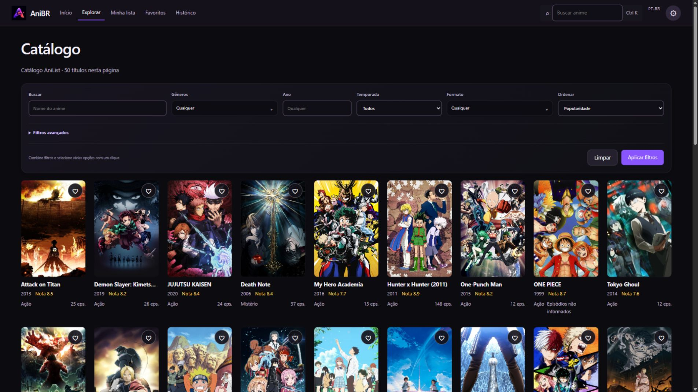
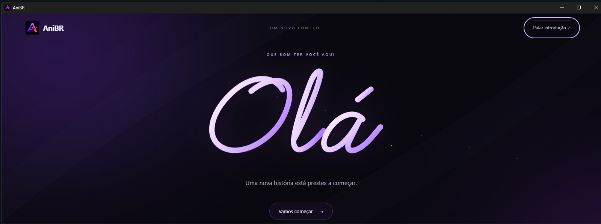
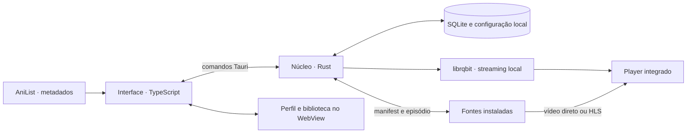

<p align="center">
  
</p>

# AniBR

### Catálogo, biblioteca pessoal e reprodução · Desktop e CLI

Projeto em português do Brasil desenvolvido por **Angelo Neri**, disponível como **aplicativo desktop em Rust, Tauri 2 e TypeScript** e **CLI em Go com interface interativa no terminal**. Reúne descoberta de animes, organização pessoal e reprodução, com dados pessoais armazenados localmente.

**[Conhecer o projeto e assistir à apresentação ↗](http://173.212.251.120:8085/)** · **[Baixar para Windows](http://173.212.251.120:8085/#download)** · **[Como adicionar fontes](http://173.212.251.120:8085/#fontes)** · **[LinkedIn](https://www.linkedin.com/in/angelo-neri-3921a72b9/)**



## O projeto

O AniBR começou como AniPT e hoje mantém duas formas de uso: **desktop e terminal**, ambas com o nome AniBR. A CLI em Go continua disponível com pesquisa, favoritos, histórico e reprodução por mpv/VLC. O desktop oferece uma interface visual própria e player integrado.

| Versão | Interface e reprodução | Como iniciar |
| --- | --- | --- |
| Desktop | Interface gráfica; player integrado, HLS e torrents | [Instalador ou portátil Windows](http://173.212.251.120:8085/#download) |
| CLI | Terminal interativo em Go; player externo mpv/VLC | [`AniBR.bat`](AniBR.bat) no Windows ou comando `anibr` |

As duas versões têm integrações próprias; os addons e o motor torrent documentados abaixo pertencem ao desktop. Consulte o [guia da CLI](docs/CLI.md) para os comandos e provedores do terminal.

Trabalhei tanto na interface quanto na integração com serviços externos, persistência, reprodução e distribuição para Windows. O catálogo utiliza metadados do AniList; as fontes de reprodução são instaladas pela pessoa e têm sua disponibilidade verificada separadamente.

O site público apresenta as funcionalidades, um vídeo de 30 segundos e os downloads. A experiência completa de reprodução funciona no aplicativo desktop.

## Funcionalidades

| Área | Recursos implementados |
| --- | --- |
| Descoberta | Destaques, busca, filtros por gênero, ano, temporada, formato e status |
| Novidades | Exibições recentes na home e histórico paginado em “Ver mais”, sem corte de 72 horas |
| Detalhes | Sinopse, gêneros, relações entre obras e trailer quando informado pelo AniList |
| Episódios | Até 15 por página, busca e imagens com fallback para banner ou capa |
| Biblioteca pessoal | Favoritos e lista com Quero assistir, Assistindo, Concluído, Pausado e Abandonado |
| Histórico | Retomada do ponto salvo, edição do progresso e remoção de registros |
| Player | HLS e vídeo direto, seleção de fontes e qualidades disponíveis, velocidade, atalhos e tela cheia |
| Torrents | Motor integrado, seleção do arquivo de vídeo, quota e limpeza manual do cache |
| Preferências | Idioma, qualidade, densidade, histórico e próximo episódio automático |
| Dados locais | Backup JSON de lista, favoritos, progresso e sinopses, com importação por identidade |
| Agenda | Horários locais e avisos opcionais enquanto o aplicativo está aberto |

A sinopse original pode receber tradução PT-BR sob demanda pelo MyMemory ou revisão manual. A tradução automática envia a sinopse pública selecionada ao serviço; o texto revisado fica salvo localmente.

## Uma primeira interação própria



A apresentação combina lettering SVG animado com escrita e retração em loop e um mosaico de cenas revelado em faixas que acompanham o cursor. As faixas compartilham um único vídeo, com pausa na inatividade e liberação dos recursos ao sair da tela.

O nome é opcional e fica no dispositivo. Também é possível continuar sem se identificar, editar o perfil ou rever a introdução nas configurações. A saudação respeita movimento reduzido e permite ativar as animações por escolha explícita.

## Stack e arquitetura

| Camada | Tecnologias |
| --- | --- |
| Interface desktop | TypeScript, Vite, HTML, CSS e SVG |
| Aplicativo nativo | Rust e Tauri 2 |
| CLI e terminal interativo | Go, Cobra, Bubble Tea, Lipgloss e Viper |
| Persistência | SQLite, configuração YAML e armazenamento local do WebView |
| Catálogo e identificação | AniList e correspondência de identidade com Kitsu |
| Reprodução | HTML5 Video, hls.js e WebView2 no Windows |
| Torrents | librqbit, Tokio e servidor local com Axum |
| Site de apresentação | HTML, CSS e JavaScript; Nginx e Docker Compose na VPS |
| Vídeo de apresentação | Composição editável em HyperFrames |



### Decisões de implementação

- **Identidade do episódio:** a correspondência entre obra, temporada e IDs das fontes é conferida antes da reprodução. Na Fenix, continuações usam a conversão explícita por episódio para série IMDb, temporada e episódio; respostas com coordenadas conflitantes são descartadas. Playlists HLS sem extensão são identificadas pela resposta da mídia. A temporada mostrada na interface é separada do índice interno da fonte.
- **Persistência local:** histórico e favoritos usam SQLite; perfil e recursos da interface usam armazenamento local. Não há cadastro obrigatório.
- **Streaming interno:** torrents são servidos por loopback, com token por processo e suporte a requisições Range para navegação no vídeo. Upload está desativado na compilação.
- **Uso de recursos:** o mosaico inicial utiliza um único decodificador; sair da apresentação remove vídeo, máscaras e eventos.
- **Backup delimitado:** o JSON exporta a biblioteca pessoal e as sinopses. URLs privadas das fontes precisam ser reinstaladas e não acompanham o backup.

## Instalar e experimentar

Versão desktop disponível: **0.3.3**, para **Windows 64 bits**.

- **[Instalador Windows](http://173.212.251.120:8085/downloads/AniBR-0.3.3-Setup.exe)** — instalação assistida.
- **[Versão portátil ZIP](http://173.212.251.120:8085/downloads/AniBR-0.3.3-Portable.zip)** — extraia a pasta e execute `AniBR.exe`.
- **[SHA-256 dos arquivos](http://173.212.251.120:8085/downloads/SHA256SUMS.txt)** — conferência dos downloads.

Ambas as versões utilizam WebView2 e os dados locais do perfil do Windows. O portátil dispensa a instalação do aplicativo, mas seus dados não ficam isolados dentro do ZIP.

Para adicionar uma fonte, abra **Configurações → Fontes instaladas**, informe o endereço do manifest e use **Adicionar fonte** e **Testar fonte**. O [guia ilustrado no site](http://173.212.251.120:8085/#fontes) mostra o processo e o acesso ao catálogo comunitário de addons.

## Executar o desktop localmente

Pré-requisitos: **Node.js 20+**, npm, Rust estável e ambiente nativo do Tauri. No Windows, instale as ferramentas C++ do Visual Studio Build Tools e o WebView2.

```powershell
git clone https://github.com/AngeLZinS2/AniPT.git
cd AniPT
npm ci
npm --prefix frontend ci
npm run dev
```

Para abrir somente a interface no navegador, execute `npm --prefix frontend run dev`. A instalação de fontes, o motor torrent e os comandos nativos exigem o aplicativo desktop.

### Testes e compilação

```powershell
npm --prefix frontend test
npm --prefix frontend run build
cargo test --manifest-path src-tauri/Cargo.toml --lib
npm run build
```

Os instaladores são gerados em `src-tauri/target/release/bundle/` e o executável em `src-tauri/target/release/anipt.exe`. O nome visível é AniBR; o identificador `br.com.anipt.desktop` preserva a continuidade dos dados locais.

A versão desktop 0.3.3 foi validada com **47 testes de frontend**, **33 testes Rust aprovados** e compilação dos pacotes Windows. Quatro testes Rust que dependem de rede são opcionais e ficam ignorados na execução padrão. A disponibilidade dos serviços externos continua dependendo da rede e das fontes.

## Usar a CLI AniBR

No Windows, mantenha `AniBR.bat` e `anibr.exe` da raiz na mesma pasta e abra o launcher. Para reproduzir vídeos, instale mpv ou VLC. Os atalhos que ainda usam `AniPT.bat` encaminham para o launcher AniBR.

Com **Go 1.24+**, é possível executar e compilar a CLI sem instalar Node.js ou Rust:

```powershell
go run ./cmd/anibr --help
go run ./cmd/anibr
go build -o anibr.exe ./cmd/anibr
.\anibr.exe search "naruto"
```

No Linux/macOS, compile com `go build -o bin/anibr ./cmd/anibr` e execute `./bin/anibr`. Verificações da CLI: `go test ./...` e `go vet ./...`.

O nome exibido e o comando passam a ser AniBR/`anibr`. Os caminhos `anipt/config.yaml`, `anipt.db` e as variáveis `ANIPT_` são preservados para compatibilidade com configurações, favoritos e histórico existentes. Veja o [guia completo da CLI](docs/CLI.md).

## Estrutura do repositório

```text
frontend/               Interface, recursos visuais e testes
src-tauri/              Núcleo Rust, banco, fontes, player e torrents
content/                Conteúdo compartilhado e decisões de arquitetura
website/                Site estático e configuração de publicação na VPS
videos/anibr-showcase/  Projeto editável do vídeo de apresentação
scripts/                Preparação de mídia e prévia local do site
docs/                   Guias, créditos e documentação do projeto
cmd/anibr/ e internal/  CLI AniBR em Go e interface de terminal
cmd/anipt/              Entrada compatível com comandos de desenvolvimento antigos
```

Prévia local do site: `node scripts/serve-anibr-site.mjs`, em `http://127.0.0.1:5180/`. O código estático está em `website/dist/` e não precisa de build. Os instaladores ficam fora do Git; veja [preparação dos downloads e publicação](website/deploy/README.md).

Guias: [primeiro acesso](docs/PRIMEIRO_ACESSO.md), [provedores da CLI](docs/PROVIDERS.md), [CLI AniBR](docs/CLI.md) e [apresentação para LinkedIn](docs/LINKEDIN.md). O `anibr.exe` da raiz é a CLI; os pacotes desktop estão nos downloads acima.

## Integrações e limites

A reprodução depende de addons compatíveis, da correspondência de IDs e da disponibilidade dos servidores ou peers. Qualidades e faixas de idioma são aquelas fornecidas pela fonte. Codecs dependem do WebView2; o app não realiza transcodificação de MKV/HEVC. Durante P2P, peers e trackers podem visualizar o IP da conexão.

Metadados de exibição no catálogo não comprovam que um vídeo esteja disponível. O AniBR não hospeda episódios e não exige conta própria; suas integrações de catálogo, tradução e reprodução utilizam serviços externos.

## Créditos e licença

O código do projeto utiliza a [licença MIT](LICENSE). O botão adaptado do Uiverse mantém sua [atribuição e licença](docs/UIVERSE_LICENSE.md); a fonte Manrope do site acompanha o [aviso OFL](website/dist/assets/Manrope-OFL.txt).

Imagens, obras e trailers pertencem aos respectivos titulares. A licença do código não transfere os direitos dessas mídias. A procedência do mosaico está registrada em [WELCOME_MEDIA_SOURCES.json](docs/WELCOME_MEDIA_SOURCES.json). Projeto independente, sem afiliação oficial com AniList, Kitsu ou os titulares das obras apresentadas.

## Autor

**Angelo Neri** · [GitHub: AngeLZinS2](https://github.com/AngeLZinS2) · [LinkedIn](https://www.linkedin.com/in/angelo-neri-3921a72b9/)

[Conhecer a apresentação](http://173.212.251.120:8085/) · [Código e decisões técnicas](https://github.com/AngeLZinS2/AniPT) · [Texto para LinkedIn](docs/LINKEDIN.md)
